<p align="center">
  
</p>

<p align="center">
  <a href="https://github.com/ishandutta2007/Awesome-Awesome-Awesome"></a><a href="https://discord.gg/jc4xtF58Ve"></a>
  <a href="https://github.com/ishandutta2007/Awesome-Product-Analytics/stargazers"></a>
  <a href="https://github.com/ishandutta2007/Awesome-Product-Analytics/network/members"></a>
  <a href="https://github.com/ishandutta2007/Awesome-Product-Analytics/issues"></a>
  <a href="https://github.com/ishandutta2007/Awesome-Product-Analytics/blob/main/LICENSE"></a>
  <a href="https://github.com/ishandutta2007"></a>
</p>

---

# 🚀 Awesome Product Analytics & Behavioral Intelligence

> 🎯 **A comprehensive, community-curated directory of top SaaS platforms and open-source GitHub projects for Product Analytics, User Event Tracking, Session Replay, Customer Journey Mapping, and Self-Hosted Product Intelligence.**

Product analytics tools empower software teams, growth engineers, and product managers to understand how users actually interact with their web and mobile applications. By observing real-world behavioral funnels, retention trends, feature adoption curves, and playback recordings, engineering and product teams can replace intuition with empirical data.

---

## 📑 Table of Contents

- [🌐 Sector Overview & Market Dynamics](#-sector-overview--market-dynamics)
- [🏢 SaaS & Hosted Platforms](#-saas--hosted-platforms)
  - [📊 SaaS Comparison Matrix](#-saas-comparison-matrix)
  - [🔍 SaaS Platform Deep Dives](#-saas-platform-deep-dives)
- [💻 Open-Source GitHub Projects](#-open-source-github-projects)
  - [⭐ Open-Source Leaderboard](#-open-source-leaderboard)
  - [🛠️ Open-Source Project Deep Dives](#️-open-source-project-deep-dives)
- [🧩 Architecture & Stack Frameworks](#-architecture--stack-frameworks)
- [🤝 How to Contribute](#-how-to-contribute)
- [💖 Support](#-support)
- [⭐ Star History](#-star-history)
- [⚖️ Disclaimer](#-disclaimer)

---

## 🌐 Sector Overview & Market Dynamics

The global product analytics market is valued at approximately **$10.5 Billion to $13.0 Billion (2025–2026)** and is projected to expand rapidly past **$25.0 Billion to $46.0+ Billion by 2030–2035**, compounding at an estimated **12.0% – 14.9% CAGR**. Growth is driven by the industry-wide mandate for **Product-Led Growth (PLG)**, warehouse-native data collection (Snowflake, BigQuery, ClickHouse), and AI-augmented predictive journey analysis.

The market structure is **moderately fragmented and intensely competitive rather than a winner-take-all monopoly**:
- **Enterprise Incumbents**: Well-funded leaders like *Contentsquare*, *Pendo*, *Amplitude*, and *Mixpanel* control large enterprise footprints and complex multi-product digital experience suites.
- **Continuous Disruption**: The market resists total concentration because low-cost SaaS alternatives and privacy-first, self-hosted open-source stacks (*PostHog*, *Umami*, *OpenPanel*, *OpenReplay*) aggressively capture developer-led startups and compliance-sensitive organizations unwilling to pay punitive per-event SaaS escalators.

---

## 🏢 SaaS & Hosted Platforms

### 📊 SaaS Comparison Matrix

The table below benchmarks prominent commercial SaaS product analytics platforms, sorted in **descending order by company size / valuation / market capitalization**.

| 🏷️ Product | 💰 Company Size / Valuation | 💳 Starting Pricing | 🎁 Free Tier Limit | 🎯 Core Capabilities |
| :--- | :--- | :--- | :--- | :--- |
| **[Contentsquare](https://contentsquare.com/)** | **$5.6B Valuation** *(Series F $600M; $250M+ ARR)* | **$39/month** *(Growth plan base; Pro & Enterprise custom quote)* | **Free Forever** *(up to 200,000 sessions/mo, 10k session replays, 1 project, 1 mo retention)* + **15-day Growth trial** | Enterprise digital experience analytics, session replay, customer journey maps, frustration scoring, zone-based heatmaps. |
| **[Pendo](https://www.pendo.io/)** | **$2.6B Valuation** *(Series F $150M; $150M+ ARR)* | **$7,000/year** *(~$583/mo Base plan up to 2k MAUs; Starter tier $2,000/yr)* | **Free Forever** *(up to 500 MAUs, core product analytics, in-app guides, NPS surveys, 12 mo retention)* | In-app user onboarding guides, feature adoption analytics, NPS sentiment collection, feedback roadmapping. |
| **[FullStory](https://www.fullstory.com/)** | **$1.8B Valuation** *(Series D $103M; $100M+ ARR)* | **$299/month** *(~$3,588/yr entry Business tier; median enterprise contract ~$27,500/yr)* | **14-day free trial** *(5,000 sessions, 20 seats, Business features)* + **Free Plan** *(1,000 sessions/mo, 10 users, 12 mo retention)* | High-fidelity session replay, error capture, rage click & dead click detection, conversion funnel diagnostics. |
| **[Heap](https://heap.io/)** | **$1.4B Valuation** *(Acquired by Contentsquare; $205M raised)* | **$3,600/year** *(~$300/mo for Growth plan base up to 300k sessions/yr)* | **Free Forever** *(up to 10,000 sessions/month, 1 project, 6 months retention, unlimited user licenses)* | Retroactive event autocapture (no manual event tagging required), Sense AI journey insights, funnel & retention charts. |
| **[Amplitude](https://amplitude.com/)** | **$1.3B Market Cap** *(Public NASDAQ: AMPL; $290M+ ARR)* | **$49/month** *(Plus tier base, or $0 base + $0.00025/event beyond 2M events/mo)* | **Free Forever** *(2,000,000 events/month, unlimited seats, 10,000 monthly session replays, core analytics)* | Behavioral cohorting, warehouse-native SQL queries, event funnels, predictive churn modeling, experimentation. |
| **[Mixpanel](https://mixpanel.com/)** | **$1.05B Valuation** *(Series C $200M; $100M+ ARR)* | **$28/month** *(Growth tier base monthly / $20/mo annual; +$0.28 per 1,000 events over limit)* | **Free Forever** *(1,000,000 events/month, 10,000 session replays, unlimited seats, 5 saved reports per user)* | Event-driven product funnels, retention matrix, interactive cohort analysis, built-in session replay, A/B report tracking. |
| **[LogRocket](https://logrocket.com/)** | **~$400M Valuation** *(Series C $25M; $52M raised; ~$40M ARR)* | **$69/month** *(billed annually; $99/mo monthly for Team plan with 10k sessions/mo)* | **Free Forever** *(1,000 sessions/month, 1-month data retention, up to 3 user seats, unlimited errors & dashboards)* | Session recording paired with frontend error tracking, network performance logging, CPU/memory profiling, UX funnels. |
| **[Kissmetrics](https://www.kissmetrics.io/)** | **~$15M Valuation** *(Acquired / Private; ~$8M estimated ARR)* | **$99/month** *(Growth plan starting at 500,000 events/month; Silver plan at $299/mo)* | **Free Forever** *(100,000 events/month, autocapture, AI chat metrics, full CLI & API access)* + **14-day trial** | Person-centric analytics, multi-touch conversion attribution, customer lifecycle tracking, revenue cohort analysis. |
| **[Woopra](https://www.woopra.com/)** | **~$10M Valuation** *(Bootstrapped / Private; ~$5M estimated ARR)* | **$999/month** *(Pro plan base starting at 5,000,000 actions/month, 25 team members)* | **30-day free trial** *(full Pro tier access up to 5M events, 2-year retention; no permanent free plan)* | Real-time omnichannel customer journey tracking, automated action triggers, user profile enrichment. |

---

### 🔍 SaaS Platform Deep Dives

- **[Contentsquare](https://contentsquare.com/)**  
  *Digital experience intelligence for high-traffic web and mobile apps.* Incorporates session replay, AI frustration scoring, zone-based revenue attribution, and form analytics. Contentsquare has consolidated the market by acquiring Heap and Hotjar. Best suited for enterprise e-commerce and consumer brands.

- **[Pendo](https://www.pendo.io/)**  
  *Product experience platform pairing product analytics with user onboarding.* Offers in-app walkthrough guides, modal announcements, NPS feedback surveys, and feature adoption scoring. Best suited for B2B product teams looking to drive feature adoption without engineering involvement for every guide.

- **[FullStory](https://www.fullstory.com/)**  
  *Session replay and digital experience analytics.* Indexed DOM capture lets UX and product teams replay exact customer sessions, identify friction points (rage clicks, dead clicks, error loops), and correlate UI bugs directly with revenue drop-offs.

- **[Heap](https://heap.io/)**  
  *Autocapture behavioral analytics.* Heap automatically logs every click, gesture, swipe, and pageview out-of-the-box, allowing teams to retroactively define events without writing code or losing historical tracking data.

- **[Amplitude](https://amplitude.com/)**  
  *Enterprise behavioral analytics with warehouse-native flexibility.* Enables deep cohort segmentation, predictive churn metrics, and multi-path funnel analysis. Its startup program offers eligible companies 100M events/month for one full year free.

- **[Mixpanel](https://mixpanel.com/)**  
  *Event-based product analytics with an intuitive self-serve query builder.* Provides interactive funnels, retention cohorts, session replays, and experimentation reports. Mixpanel's startup program provides up to 1B events for one year free for qualifying teams.

- **[LogRocket](https://logrocket.com/)**  
  *Session replay integrated with frontend telemetry and error monitoring.* Combines full DOM video-like playback with console logs, network request/response timings, and Redux/Vue state changes. Keeps errors and dashboards unlimited across plans.

- **[Kissmetrics](https://www.kissmetrics.io/)**  
  *Person-based tracking focused on multi-touch customer journey attribution.* Historically pioneered individual-centric metrics rather than anonymous aggregate counters, mapping marketing channels to lifetime subscriber value.

- **[Woopra](https://www.woopra.com/)**  
  *Real-time customer journey analytics.* Tracks user touchpoints across web, mobile, email, and helpdesk tools into a unified customer profile with automated webhook trigger capabilities.

---

## 💻 Open-Source GitHub Projects

Open-source and self-hosted product analytics solutions provide **complete data sovereignty**, **GDPR/CCPA compliance**, and **zero per-event SaaS markup**. They eliminate vendor lock-in and allow direct SQL/warehouse querying against your own infrastructure (PostgreSQL, ClickHouse, Kafka, Snowflake).

### ⭐ Open-Source Leaderboard

Sorted in **descending order by GitHub Stars_Count**.

| 🏆 Project | ⭐ GitHub_Stars | ⚖️ License | 🛠️ Primary Tech Stack | 💡 Primary Use Case |
| :--- | :--- | :--- | :--- | :--- |
| **[Metabase](https://github.com/metabase/metabase)** | [](https://github.com/metabase/metabase/stargazers) | AGPL-3.0 / Commercial | Clojure, TypeScript, SQL | Self-hosted BI & product analytics dashboards with visual query builder. |
| **[PostHog](https://github.com/PostHog/posthog)** | [](https://github.com/PostHog/posthog/stargazers) | MIT / Commercial | Python, TypeScript, ClickHouse, Kafka | The complete open-source Product OS: analytics, replay, feature flags & surveys. |
| **[Umami](https://github.com/umami-software/umami)** | [](https://github.com/umami-software/umami/stargazers) | MIT | Next.js, Prisma, PostgreSQL, MySQL | Lightweight, privacy-focused, cookie-free analytics alternative to Google Analytics. |
| **[Plausible](https://github.com/plausible/analytics)** | [](https://github.com/plausible/analytics/stargazers) | AGPL-3.0 | Elixir, Phoenix, ClickHouse, PostgreSQL | Lightweight, privacy-first web & product analytics with zero cookies and no banner requirement. |
| **[Matomo](https://github.com/matomo-org/matomo)** | [](https://github.com/matomo-org/matomo/stargazers) | GPL-3.0 | PHP, JavaScript, MySQL/MariaDB | Enterprise web & product analytics with 100% data ownership and GDPR compliance. |
| **[rrweb](https://github.com/rrweb-io/rrweb)** | [](https://github.com/rrweb-io/rrweb/stargazers) | MIT | TypeScript | Open-source web session recorder and player powering modern session replay tools. |
| **[OpenReplay](https://github.com/openreplay/openreplay)** | [](https://github.com/openreplay/openreplay/stargazers) | ELv2 / Apache-2.0 | Go, TypeScript, ClickHouse, Kafka | Self-hosted session replay, devtools inspection, error tracking, and funnel analysis. |
| **[Highlight.io](https://github.com/highlight/highlight)** | [](https://github.com/highlight/highlight/stargazers) | Apache-2.0 | Go, React, ClickHouse, OpenTelemetry | Full-stack observability combining session replay, frontend error monitoring & traces. |
| **[GrowthBook](https://github.com/growthbook/growthbook)** | [](https://github.com/growthbook/growthbook/stargazers) | MIT | TypeScript, Node.js, Next.js | Open-source feature flagging and statistical A/B testing connected to your data warehouse. |
| **[OpenPanel](https://github.com/Openpanel-dev/openpanel)** | [](https://github.com/Openpanel-dev/openpanel/stargazers) | AGPL-3.0 | Next.js, Rust, ClickHouse, Redis | Open-source Mixpanel alternative with event tracking, funnels & session recordings. |
| **[Snowplow](https://github.com/snowplow/snowplow)** | [](https://github.com/snowplow/snowplow/stargazers) | Apache-2.0 / BSL | Scala, Java, Kafka, Snowflake, BigQuery | Enterprise-grade behavioral event data pipeline generating clean, warehouse-ready tables. |
| **[Flagsmith](https://github.com/Flagsmith/flagsmith)** | [](https://github.com/Flagsmith/flagsmith/stargazers) | BSD-3-Clause | Python, Django, React, PostgreSQL | Open-source feature flags and remote configuration to measure feature rollout impact. |
| **[Countly](https://github.com/Countly/countly-server)** | [](https://github.com/Countly/countly-server/stargazers) | AGPL-3.0 / Commercial | Node.js, MongoDB, JavaScript | Mobile & web product analytics with push notifications, crashes & user profiles. |
| **[Jitsu](https://github.com/jitsucom/jitsu)** | [](https://github.com/jitsucom/jitsu/stargazers) | MIT | TypeScript, Go, ClickHouse, Kafka | Open-source data ingestion engine streaming user event data directly into data warehouses. |
| **[Ackee](https://github.com/electerious/Ackee)** | [](https://github.com/electerious/Ackee/stargazers) | MIT | Node.js, MongoDB, GraphQL | Node.js-based self-hosted analytics for developers seeking a 100% private tracker. |
| **[RudderStack](https://github.com/rudderlabs/rudder-server)** | [](https://github.com/rudderlabs/rudder-server/stargazers) | SSPL-1.0 | Go, PostgreSQL, Redis | Open-source customer data pipeline (Segment alternative) for developer-first tracking. |
| **[Aptabase](https://github.com/aptabase/aptabase)** | [](https://github.com/aptabase/aptabase/stargazers) | AGPL-3.0 | Rust, TypeScript, ClickHouse | Open-source, privacy-first analytics built specifically for desktop and mobile apps. |
| **[Swetrix](https://github.com/swetrix/swetrix)** | [](https://github.com/swetrix/swetrix/stargazers) | AGPL-3.0 | TypeScript, Node.js, ClickHouse | Lightweight, cookieless web & product analytics suite with performance and error tracking. |

---

### 🛠️ Open-Source Project Deep Dives

- **[PostHog](https://github.com/PostHog/posthog)** [](https://github.com/PostHog/posthog/stargazers)  
  *The undisputed leader in open-source product intelligence.* Delivers an all-in-one Product OS featuring event analytics, session recordings, heatmaps, feature flags, A/B experiments, survey prompts, error tracking, and warehouse data synchronization. Runs on ClickHouse for lightning-fast aggregation over billions of events.

- **[Umami](https://github.com/umami-software/umami)** [](https://github.com/umami-software/umami/stargazers)  
  *A clean, fast, privacy-first alternative to Google Analytics.* Built with Next.js and Prisma, supporting MySQL or PostgreSQL. Captures pageviews, custom events, device metrics, and referral funnels without storing personally identifiable information or triggering cookie banners.

- **[Plausible Analytics](https://github.com/plausible/analytics)** [](https://github.com/plausible/analytics/stargazers)  
  *Lightweight and ultra-fast web analytics.* With a script footprint under 1 KB, Plausible provides an intuitive single-page dashboard displaying traffic sources, top pages, conversion goals, and custom event funnels without cookie banners.

- **[Matomo](https://github.com/matomo-org/matomo)** [](https://github.com/matomo-org/matomo/stargazers)  
  *The battle-tested, enterprise open-source analytics platform.* Provides 100% data ownership, full GDPR compliance audits, tag manager, heatmaps, session recordings, and custom goal funnels.

- **[rrweb](https://github.com/rrweb-io/rrweb)** [](https://github.com/rrweb-io/rrweb/stargazers)  
  *The foundational open-source web session recording engine.* rrweb serializes DOM mutations and user interactions (mouse movement, scroll, inputs) into a lightweight JSON event stream that can be accurately replayed. Powers many commercial and self-hosted session playback tools.

- **[OpenReplay](https://github.com/openreplay/openreplay)** [](https://github.com/openreplay/openreplay/stargazers)  
  *Self-hosted session replay and developer monitoring suite.* Replays exactly what users did, while simultaneously recording network payloads, Redux actions, console logs, and UX frustration indicators.

- **[Highlight.io](https://github.com/highlight/highlight)** [](https://github.com/highlight/highlight/stargazers)  
  *Open-source full-stack observability platform.* Unifies session playback with backend distributed tracing and frontend exception tracking, allowing engineers to jump directly from a server error trace to the user's recorded session.

- **[GrowthBook](https://github.com/growthbook/growthbook)** [](https://github.com/growthbook/growthbook/stargazers)  
  *Warehouse-native feature flagging and experimentation engine.* Connects directly to Snowflake, BigQuery, ClickHouse, or Redshift to analyze A/B test experiments using Bayesian or Frequentist statistical models without syncing event data to external servers.

- **[OpenPanel](https://github.com/Openpanel-dev/openpanel)** [](https://github.com/Openpanel-dev/openpanel/stargazers)  
  *Modern open-source Mixpanel alternative.* Built on ClickHouse and Rust, OpenPanel offers event analytics, user profiles, funnel analysis, and session replay with transparent, self-hostable licensing.

- **[Snowplow](https://github.com/snowplow/snowplow)** [](https://github.com/snowplow/snowplow/stargazers)  
  *Industrial-grade behavioral data pipeline.* Validates, enriches, and models real-time behavioral event streams into your cloud data warehouse with schema enforcement and custom entity models.

- **[Flagsmith](https://github.com/Flagsmith/flagsmith)** [](https://github.com/Flagsmith/flagsmith/stargazers)  
  *Open-source feature flag and remote configuration engine.* Lets teams toggle features dynamically, run multivariate experiments, and segment releases to specific user cohorts.

- **[Countly](https://github.com/Countly/countly-server)** [](https://github.com/Countly/countly-server/stargazers)  
  *Mobile-first product analytics and engagement platform.* Provides real-time event analytics, in-app push messaging, crash analytics, and user cohort management for iOS, Android, and web apps.

- **[Jitsu](https://github.com/jitsucom/jitsu)** [](https://github.com/jitsucom/jitsu/stargazers)  
  *Open-source customer data ingestion platform.* Acts as a lightweight, modern Segment replacement that captures web events and streams them with schema transformation directly into ClickHouse, BigQuery, or Postgres.

- **[Ackee](https://github.com/electerious/Ackee)** [](https://github.com/electerious/Ackee/stargazers)  
  *Self-hosted Node.js analytics server.* Features a clean, minimalist UI for tracking page views, bounce rates, visit durations, and referrer data with GraphQL API support and strict privacy protection.

- **[RudderStack](https://github.com/rudderlabs/rudder-server)** [](https://github.com/rudderlabs/rudder-server/stargazers)  
  *Enterprise customer data infrastructure.* Collects, routes, and transforms event data from web, mobile, and server sources to hundreds of analytics, marketing, and warehouse destinations.

- **[Aptabase](https://github.com/aptabase/aptabase)** [](https://github.com/aptabase/aptabase/stargazers)  
  *Privacy-first telemetry for mobile, desktop, and web apps.* Written in Rust and ClickHouse, Aptabase provides native SDKs for Flutter, React Native, Swift, Tauri, and Electron with zero device profiling.

- **[Swetrix](https://github.com/swetrix/swetrix)** [](https://github.com/swetrix/swetrix/stargazers)  
  *Fully open-source, cookieless, and GDPR/CCPA/PECR compliant analytics platform.* Tracks traffic sources, custom event funnels, page load performance, and client-side JavaScript errors.

---

## 🧩 Architecture & Stack Frameworks

When architecting a production product analytics stack, modern engineering teams frequently combine complementary open-source components:

```
┌────────────────────────────────────────────────────────┐
│             Web, Mobile & Backend SDKs                 │
│      (JavaScript, React, iOS, Android, Python)         │
└──────────────────────────┬─────────────────────────────┘
                           │ Event Stream & DOM Mutations
                           ▼
┌────────────────────────────────────────────────────────┐
│             Event Ingestion & Routing Layer            │
│                 (Jitsu / RudderStack)                  │
└──────────────┬───────────────────────────┬─────────────┘
               │ Structured Events         │ Raw Sessions
               ▼                           ▼
┌──────────────────────────────┐ ┌───────────────────────┐
│     ClickHouse / OLAP DB     │ │  Session Replay Store │
│  (Fast aggregate queries)    │ │  (OpenReplay / rrweb) │
└──────────────┬───────────────┘ └───────────────────────┘
               │
               ▼
┌────────────────────────────────────────────────────────┐
│             Visualization & Experimentation            │
│       (PostHog / OpenPanel / GrowthBook / Metabase)    │
└────────────────────────────────────────────────────────┘
```

- **For Full-Stack Product OS**: Deploy **PostHog** on Kubernetes/ClickHouse for all-in-one events, session replays, feature flags, and survey analysis.
- **For Warehouse-Native Analytics**: Use **Jitsu** or **Snowplow** to stream clean events into Snowflake or ClickHouse, paired with **GrowthBook** for A/B testing and **Metabase** for BI queries.
- **For Deep Session Debugging**: Pair **OpenReplay** or **Highlight.io** with your application frontend to inspect network requests, Redux states, and DOM recordings.
- **For Lightweight Privacy Compliance**: Deploy **Umami** or **Plausible** on a minimal VPS for clean, cookie-banner-free tracking.

---

## 🤝 How to Contribute

Contributions from the developer and product community are warmly welcomed!

1. 🍴 **Fork the repository** on GitHub.
2. 🌿 **Create a descriptive feature branch** (`git checkout -b add-analytics-tool`).
3. 📝 **Add or update an entry** in `README.md` following the existing format:
   - Include tool name, official URL, exact starting pricing, free tier limits, and factual descriptions.
   - For open-source tools, include the repository URL, exact license, and primary tech stack.
4. 🧪 **Verify all links and markdown formatting** before submitting.
5. 🚀 **Submit a Pull Request** with a concise explanation of why the tool should be added.

---

## 💖 Support

If you find this curated directory helpful for evaluating product analytics stacks, consider supporting the project:

- ⭐ **Star this repository** to help other product teams and developers discover it.
- 🍴 **Fork and contribute** updates, new tools, and benchmarks.
- 📢 **Share this list** on Twitter/X, LinkedIn, Reddit, or Discord communities.
- ☕ **Sponsor or buy a coffee**: Support ongoing maintenance via the [GitHub Sponsor Dashboard](https://github.com/sponsors/ishandutta2007).

Your sponsorship directly funds research, benchmark verifications, and directory curation. Thank you for being part of the open-source community!

---

## ⭐ Star History

[](https://star-history.dera.page/#ishandutta2007/Awesome-Product-Analytics&type=date&legend=top-left)

---

## ⚖️ Disclaimer

- This repository is a **community-curated informational resource** — it does not constitute financial, investment, or commercial endorsement of any vendor.
- SaaS pricing, session limits, and free tiers change frequently. The pricing figures and limits listed represent verified tier benchmarks as of early 2026. Always consult official vendor pricing pages before entering commercial contracts.
- Self-hosting open-source analytics platforms eliminates recurring SaaS subscription costs but transfers operational responsibilities (scaling OLAP databases like ClickHouse, managing Kafka queues, monitoring storage retention, and performing security patches) to your team.

---

<p align="center">
  <b>Awesome Product Analytics</b> • Maintained with ❤️ by <a href="https://github.com/ishandutta2007">Ishan Dutta</a> and community contributors.
</p>
